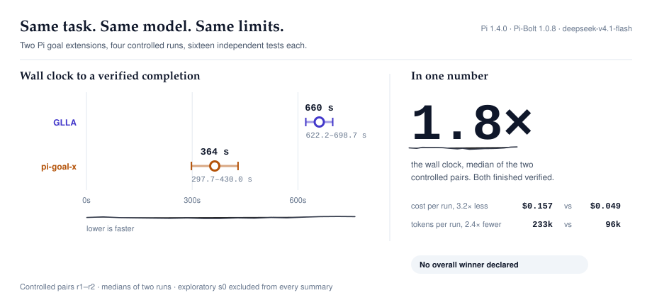
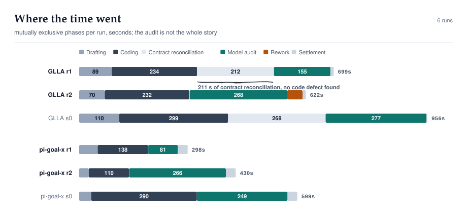
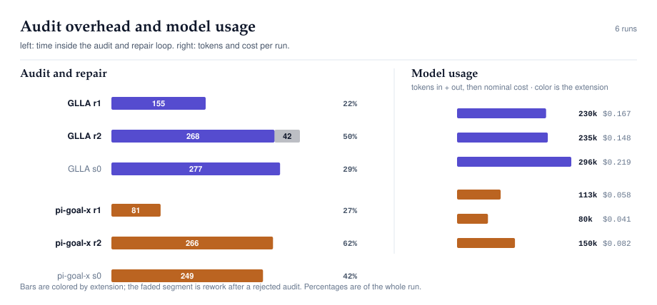
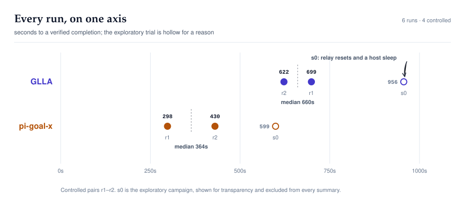

# Pi goal-extension benchmark: GLLA vs pi-goal-x

An isolated, reproducible comparison of two goal-management extensions for
[Pi](https://github.com/earendil-works/pi), the coding agent. Both extensions are Pi
extensions; every run used [Pi-Bolt](https://github.com/opensec-git/Pi-Bolt), Pi's
compiled fork, as the pinned runtime (Pi-Bolt 1.0.8 / Pi 1.4.0) so each competitor
got an identical, isolated environment. Same task, same model, same container
limits, same acceptance tests.

Both extensions completed the task with working, independently verified
implementations. **No overall winner is declared.** The measurements show a
consistent speed difference and no measurable difference in acceptance-test
quality; the reasons are set out below, with the uncertainty.

<picture>
  <source media="(prefers-color-scheme: dark)" srcset="assets/hero-dark.svg">
  
</picture>

<sub>Median and range of the two controlled pairs. Both extensions finished; neither is declared a winner.</sub>

The charts are generated from the committed measurements and designed as one
system — type, color, annotation and accessibility rules are in
[`docs/DESIGN.md`](docs/DESIGN.md). Each exists in a light and a dark variant.

## Headline numbers

| | GLLA | pi-goal-x |
|---|---:|---:|
| Wall clock, controlled pairs (median, range) | **660.5 s** (622.2–698.7) | **363.9 s** (297.7–430.0) |
| Pair 1 (GLLA first) | 698.7 s | 297.7 s |
| Pair 2 (pi-goal-x first) | 622.2 s | 430.0 s |
| Input / output tokens (median) | 170.7k / 61.9k | 79.5k / 17.0k |
| Nominal cost at list prices (median) | $0.157 | $0.049 |
| Model audit time (per run) | 154.8 s, 267.9 s | 80.8 s, 265.5 s |
| Rework after a rejected audit | 41.8 s (in `r2`) | none |
| Independent acceptance tests | 16/16, 16/16 | 16/16, 16/16 |
| Manual interventions | 0, 0 | 0, 0 |
| Final state | `VERIFIED_COMPLETE` ×2 | `VERIFIED_COMPLETE` ×2 |

The exploratory campaign (`s0`) is included for transparency: a relay defect hit
the GLLA run and a macOS clamshell sleep overlapped the pi-goal-x run, so its
timings are marked and excluded from the medians.

## Where the time went

Each run is split into mutually exclusive phases from recorded timestamps:
drafting and confirmation, coding and self-testing, contract reconciliation
(everything between the completion claim and the audit actually running), the
audit rounds, rework between audit rounds, and settlement.

<picture>
  <source media="(prefers-color-scheme: dark)" srcset="assets/phases-dark.svg">
  
</picture>

Two things stand out and both are consistent across pairs:

- The difference is not only audit overhead. pi-goal-x also reaches its
  completion claim sooner (median 163 s vs 313 s from process start), after a
  shorter drafting phase.
- GLLA's completion window is dominated by two different things depending on the
  run: in `r1` it is **211 s of contract reconciliation** before any audit ran;
  in `r2` it is **two audit rounds** (110 s rejected, 42 s of repairs, 158 s
  approved).

## Audit overhead and model usage

<picture>
  <source media="(prefers-color-scheme: dark)" srcset="assets/efficiency-dark.svg">
  
</picture>

Left panel: the audit itself and the share of the whole run; the faded segment is
repair after a rejected audit. Right panel: tokens in and out, with nominal cost
at list prices (a nominal figure, not a bill). Token counts come from the Pi
session transcripts.

GLLA's independent auditor rejected one completion in `r2` with a real defect:
the new escaping note had been added to the module docstring, which `argparse`
uses as the `--help` description, so the command-line interface changed. The
agent repaired it and the second audit approved. pi-goal-x made the same class of
change in `r1` and its auditor approved it; that regression is visible only in
the independent CLI-parity test (see below).

The exploratory `s0` runs are shown for transparency; the controlled pairs are
what every headline number uses.

## The two extensions, side by side

| | GLLA | pi-goal-x |
|---|---|---|
| Package | `pi-goal-list-loop-audit` | `pi-goal-x` |
| Version / commit | 0.39.54 / `b1c36dc` | 0.34.1 / `b0fc15e` |
| License | GPL-3.0 | MIT |
| Upstream | [DraconDev/pi-goal-list-loop-audit](https://github.com/DraconDev/pi-goal-list-loop-audit) | [tmonk/pi-goal-x](https://github.com/tmonk/pi-goal-x) |
| Entry command used | `/goal plan <task>` | `/goal <task>` |
| Planning style observed | deep planning: investigates the repository first, drafts an expanded contract, interviews in rounds | task-list drafting: objective plus derived tasks and completion requirements |
| Confirmation in these runs | 3 dialogs in `r1` (including a contract replacement), 1 in `r2` | 2 dialogs in both runs (auditor enablement, then the draft) |
| Completion auditor | detached Node worker that spawns a separate `pi --mode rpc` session | in-process nested agent session |
| Deterministic pre-audit gate | yes (rejected twice in `r1` because the stored verification contract was not mechanically executable) | none observed |
| Audits / rejections in replication | 1 / 0 (`r1`), 2 / 1 (`r2`) | 1 / 0 (`r1`), 1 / 0 (`r2`) |

Both were configured identically: same model for implementation and audit, same
thinking level, same container limits, same task bytes, same scripted answers to
their dialogs.

## What was measured

1. **Speed** — external wall clock from process launch to the extension's own
   terminal goal state, verified independently afterwards.
2. **Quality** — a frozen acceptance suite (10 tests) plus an adversarial suite
   (6 tests) that neither extension ever saw, run after the fact in a clean
   container against each candidate's diff.
3. **Cost** — tokens from the Pi transcripts, priced at list.
4. **Reliability** — settled without human intervention, audit rejections that
   led to real repairs, redundant verification after acceptance, stalls.

The task was genuine and identical for both: harden `bench/report.py` in the Pi
checkout Pi-Bolt is built from
so that every dynamic string inserted into generated SVG is escaped exactly once,
without changing ordinary output or the CLI, with regression tests. The task text
and its SHA-256 are in [`results/shared-task.md`](results/shared-task.md).

## Every run, on one axis

<picture>
  <source media="(prefers-color-scheme: dark)" srcset="assets/timing-dark.svg">
  
</picture>

## The four controlled runs

| Run | Order | UTC start | Wall clock | Model requests | Relay failures | Outcome |
|---|---|---|---:|---:|---:|---|
| GLLA `r1` | 1st | 2026-10-31 15:00:15 | 698.7 s | 49 | 0 | verified complete |
| pi-goal-x `r1` | 2nd | 2026-10-31 15:13:18 | 297.7 s | 27 | 0 | verified complete |
| pi-goal-x `r2` | 1st | 2026-10-31 15:22:30 | 430.0 s | 23 | 0 | verified complete |
| GLLA `r2` | 2nd | 2026-10-31 15:30:37 | 622.2 s | 42 | 0 | verified complete |

No host sleep, no Docker interruption, no OOM kill, no relay failure in any of
the four. The full reports are
[`reports/REPLICATION_REPORT.md`](reports/REPLICATION_REPORT.md) (controlled) and
[`reports/FINAL_REPORT.md`](reports/FINAL_REPORT.md) (exploratory, with its
confounders documented).

## Independent evaluation

Every candidate is tested by the same frozen suite, in a throwaway container,
against the pristine baseline:

| Run | Acceptance (10) | Adversarial (6) | `--help` byte-identical | Datasets modified |
|---|---|---|---|---|
| GLLA `r1` | 10 | 6 | yes | none |
| GLLA `r2` | 10 | 6 | yes | none |
| pi-goal-x `r1` | 10 | 6 | **no** | none |
| pi-goal-x `r2` | 10 | 6 | yes | none |

Quality scored on the same rubric for every run (goal understanding 20,
implementation 35, tests 20, scope 10, completion accuracy 15):

| | GLLA | pi-goal-x |
|---|---:|---:|
| Per-run totals | 93, 96 | 89, 94 |
| Median | 94.5 | 91.5 |

The only difference is the CLI-parity check, which was written **after** the runs
from the task's own "preserve the existing command-line interface" constraint and
applied blind to all four trees. Without it the four implementations are
indistinguishable on the acceptance suite.

## What this does not show

- **n = 2 pairs.** The direction is consistent across both orders and every
  phase, but the median of two values is a weak estimate.
- **One host, one model.** No claim is made about other models, reasoning levels
  or hardware.
- **The quality difference is one post-hoc check**, not a stable separation.
- **Auditor-crash behavior is untested.** The relay can inject slow, failing and
  aborted audit calls; those scenarios were not run, so no claim is made about
  recovery from an auditor failure.
- **The two campaigns are not directly comparable in absolute seconds**: `s0`
  used a higher thinking level and a smaller memory limit, and its runs were
  affected by environment faults.

Why no winner: the speed result is consistent and survives the removal of the
first campaign's confounders, but it rests on two pairs; the quality result is
inside the noise of a single check. Declaring an overall winner would overstate
what two paired trials can support.

## Reproduce it

```bash
git clone https://github.com/ddawnlll/goal-extension-benchmark
cd goal-extension-benchmark
LOCAL_LLM_KEY='...' bash harness/fetch_inputs.sh
export DOCKER_HOST=unix://$HOME/.colima/default/docker.sock
python3 harness/preflight.py          # must print PREFLIGHT STABLE
python3 harness/run_trial.py --trial r1 --order glla,goal-x --max-seconds 2700 --thinking low --memory 6g
python3 harness/run_trial.py --trial r2 --order goal-x,glla --max-seconds 2700 --thinking low --memory 6g
python3 harness/replication.py evaluate r1 && python3 harness/replication.py evaluate r2
python3 tools/derive_phases.py && python3 tools/make_charts.py --check
```

Full prerequisites and the endpoint configuration are in
[`docs/REPRODUCE.md`](docs/REPRODUCE.md); the isolation model, instrumentation and
scoring rubric are in [`docs/METHODOLOGY.md`](docs/METHODOLOGY.md).

## Repository map

```
assets/        generated SVG charts (regenerate with tools/make_charts.py)
reports/       FINAL_REPORT.md (exploratory), REPLICATION_REPORT.md (controlled)
results/       per-run patches, metrics, blind evaluations, run logs, phase model
harness/       runner, model relay, preflight, collectors, container definitions
evaluation/    frozen acceptance and adversarial tests, baseline artifacts
tools/         chart generation, phase derivation, publication checks
docs/          design system, methodology, reproduction, security policy, attribution
```

The committed charts are generated from committed data: `tools/make_charts.py
--check` reproduces them byte for byte from a clean checkout.

## License and attribution

Benchmark code and records: MIT (see [`LICENSE`](LICENSE)). Pi, Pi-Bolt, GLLA and
pi-goal-x keep their own licenses and are not redistributed here; see
[`docs/ATTRIBUTION.md`](docs/ATTRIBUTION.md). This is an independent evaluation,
not affiliated with any of the projects.
